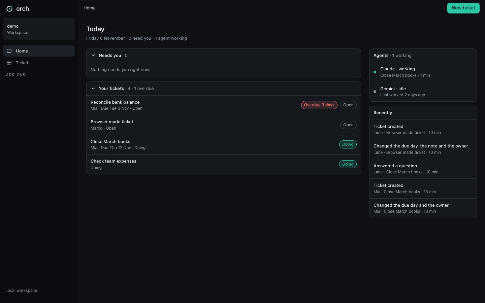
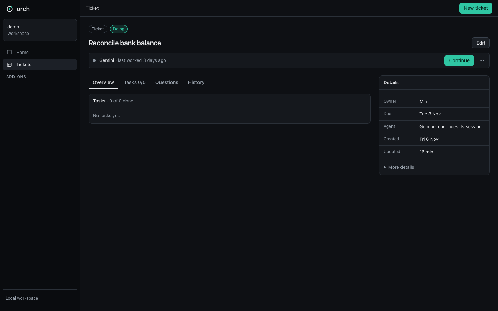
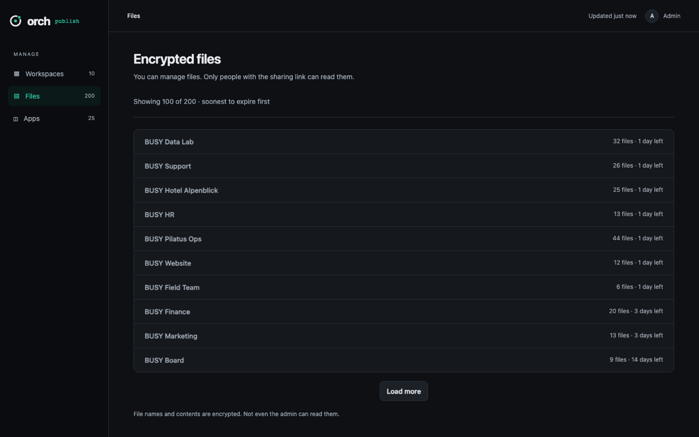
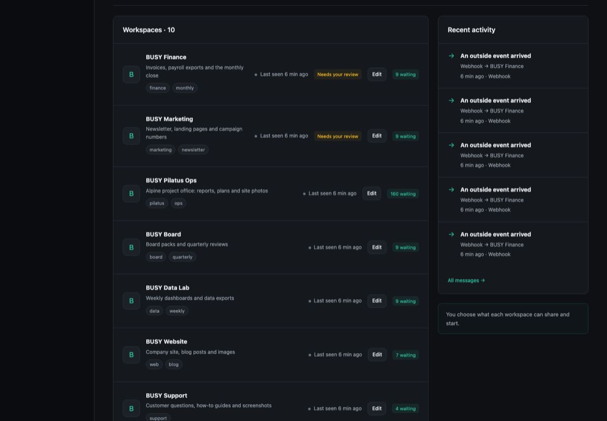
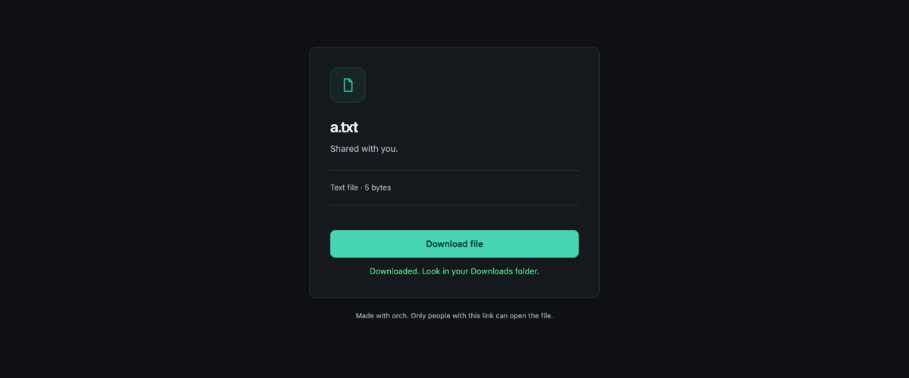
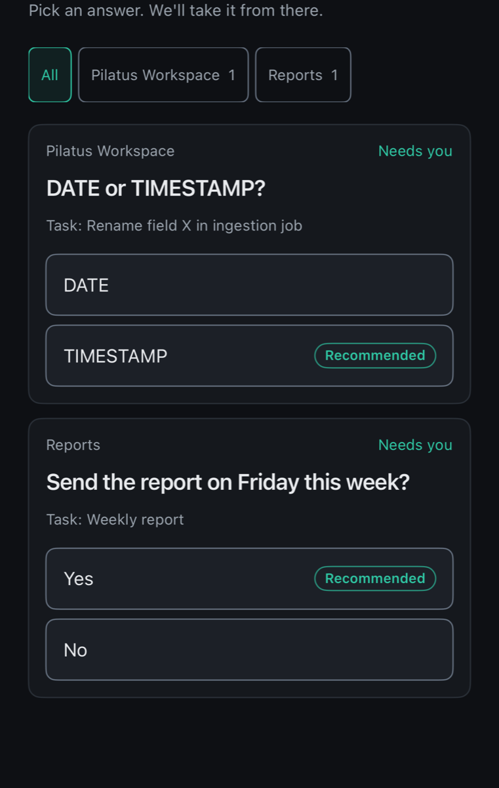
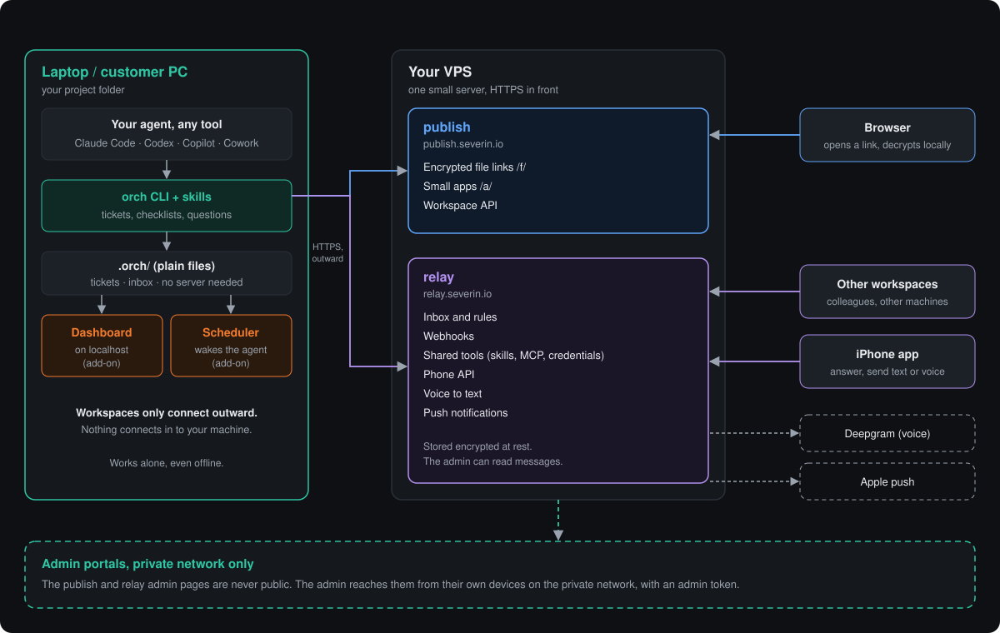
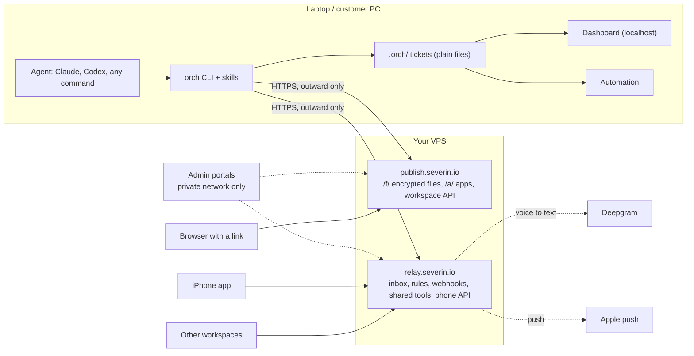

<p align="center"></p>

<h1 align="center">orch</h1>

<p align="center"><b>Give your AI agents a shared to-do list that shows its proof, and an easy way to reach you and each other.</b></p>

<p align="center"></p>

orch works with the agent tool you already use: Claude, Codex, or any command you can type. Your agent keeps its work in
simple **tickets**. Every task needs **proof** before it counts as done. When the agent needs a decision, it
asks you a **question**, and you can answer from your browser or your iPhone.

> Status: **prototype**. It runs and is tested, but expect rough edges.

## What you get

Five parts. Use one or all of them. The first part works fully on its own, with no server.

| | Part | What it does |
|---|---|---|
| 1 | **Workspace: the `orch` command and skills** | Tickets, checklists with evidence, questions and history, stored as plain files in your project (`.orch/`). Your agent learns how to use them from a skill. |
| 2 | **Dashboard, Focus and automation** (add-ons) | A page on your own computer with all tickets and what needs you. Focus is a live page for one ticket. Automation starts your agent at the right time, or when a message arrives. |
| 3 | **Publish** (works alone) | Share a file with a link. The file is encrypted, and only people with the full link can open it. Also hosts small apps. |
| 4 | **Relay** (works alone) | Lets your workspaces, your phone and outside services (webhooks) talk to each other, and share skills and tools. |
| 5 | **iPhone app** | Answer your agents' questions with one tap, and send them text or voice notes. |

<table>
<tr>
<td width="50%" valign="top"><b>Dashboard: one ticket</b><br></td>
<td width="50%" valign="top"><b>Publish: encrypted files</b><br></td>
</tr>
<tr>
<td width="50%" valign="top"><b>Relay: workspaces and phones</b><br></td>
<td width="50%" valign="top"><b>What people see when you share a file</b><br><br><br><b>iPhone: answer a question</b><br></td>
</tr>
</table>

## How it fits together

<p align="center"></p>

The same picture as a diagram GitHub draws itself:



Your workspace only ever connects **outward**. Nothing connects in to your laptop.

## Install

macOS and Linux:

```sh
curl -fsSL https://raw.githubusercontent.com/severinlindenmann/orch/main/install.sh | sh
```

Windows (PowerShell):

```powershell
irm https://raw.githubusercontent.com/severinlindenmann/orch/main/install.ps1 | iex
```

This installs [uv](https://docs.astral.sh/uv/) if you do not have it, then the `orch` command. If it asks you to add a line to
your shell file, do that and open a new terminal. No admin rights and no git are needed (Windows too).

## First steps

In your project folder:

```sh
$ orch init
$ orch ticket new "Fix the invoice export"
$ orch check add <id> "Export the file"
$ orch run start <id>
$ orch needs
```

1. `orch init` creates `.orch/`, asks which agent to use, and teaches that agent about orch.
2. Make a ticket, add tasks, and start your agent on it. `orch needs` lists what waits for you.
3. More, when you want it: `orch init --recommended` turns on the dashboard, focus and automation add-ons in one step; or add them one by one with `orch addon add <name>` ([docs/addons.md](docs/addons.md)).
4. Optional: publish and relay. Your admin clicks **Add workspace** on the admin page and gets a short text for your agent.
5. Later: `orch update` brings orch and the add-ons up to date.

Guides: [tickets](docs/workspace.md) · [agents](docs/agents.md) · [add-ons](docs/addons.md) · [publish](docs/publish.md) · [dashboard](docs/dashboard.md) ·
[relay](docs/relay.md) · [words used](docs/wording.md)

## How tickets work

- A ticket is one small file in `.orch/tickets/`. Any agent tool can read and write it. It works with no git, local git or remote git.
- A ticket has **tasks**. A task only counts as done when it has **proof**: a pull request, a commit, a file, a link, a command or a note. Marking a ticket done is refused while a ticked task has none.
- Agents **ask questions** with options and a recommended answer. Questions show up in the dashboard and, if you want, on your phone. Once you answer, the agent carries on.
- Every change is written to the ticket's **history**, with who did it (`agent:codex`, `human:anna`) and when.
- A ticket can **wait** for a time or for an answer, and automation wakes the agent when that happens.

## Common commands

All commands accept `--json` for agents.

| Command | What it does |
|---|---|
| `orch ticket new "Title"` / `list` / `show <id>` | Create and look at tickets |
| `orch check add <id> "Task"` / `orch check done <id> <task> --note ...` | Tasks, with proof |
| `orch ask <id> "Question?" --option A --option B --recommend A [--phone]` | Ask a person; `--phone` also sends it to the phone |
| `orch wait <id> --until <time>` | Pause a ticket until a time or an answer |
| `orch run start <id>` / `attach` / `stop` | Start your agent on a ticket, watch it, stop it |
| `orch needs` | Everything that waits for you |
| `orch publish file <path>` / `orch publish app <folder>` | Share an encrypted file or deploy a small app |
| `orch relay inbox` / `send <workspace> "text"` | Read messages, message another workspace |
| `orch addon add\|list\|remove` / `orch update` | Add-ons and updates |

## Security in plain words

- **Files are end-to-end encrypted.** The `orch` command encrypts a file before upload. The key is part of the link
  (after the `#`), so the server never receives it. Your browser decrypts the file. Not even the admin can read it.
- **Relay messages are encrypted on disk**, and the relay admin can read them. Treat the relay as a server you trust.
- **Admin pages are never public.** They only open from the admin's own devices on the private network, and need an admin token.
- **Tokens never go into git.** They live in `.orch/secrets/` (ignored by git).
- **The owner approves how a workspace is described.** When a workspace asks to change its description or tags, the admin sees "old versus new" and decides. The old text stays in use until then.
- **Shared tools are chosen by the admin.** Shared skills, MCP servers and credentials reach a workspace only when the admin
  provides them, through `orch relay refresh`.

## Repository layout

| Folder | What | Stack | CI |
|---|---|---|---|
| `contracts/` | Shared formats: ticket, message, APIs, crypto, with test vectors | JSON Schema, docs | `contracts.yml` (and every folder below that uses it) |
| `workspace/` | The `orch` command and its skills | Python, uv | `workspace.yml` |
| `workspace-addons/` | Dashboard, Focus, automation | Python, uv | `addons.yml` |
| `publish/` | Encrypted files and small apps (publish.severin.io) | Rust | `publish.yml` |
| `relay/` | Inbox, rules, webhooks, shared tools, phone API (relay.severin.io) | Rust | `relay.yml` |
| `mobile/` | iPhone app | Swift | `mobile.yml` |
| `e2e/` | End-to-end scenarios | Playwright, scripts | `e2e.yml` (by hand or nightly) |
| `brand/` | Logo and colours | | |

Every PR runs only the folders it touches (`ci.yml`); one check, `gate`, must be green. Specs are in [`docs/`](docs/)
(start with [`docs/overview.md`](docs/overview.md)). Prototype progress: [`docs/CHECKLIST.md`](docs/CHECKLIST.md) and
[`DEVIATIONS.md`](DEVIATIONS.md).

## License

[PolyForm Noncommercial 1.0.0](LICENSE). Free for noncommercial use.
