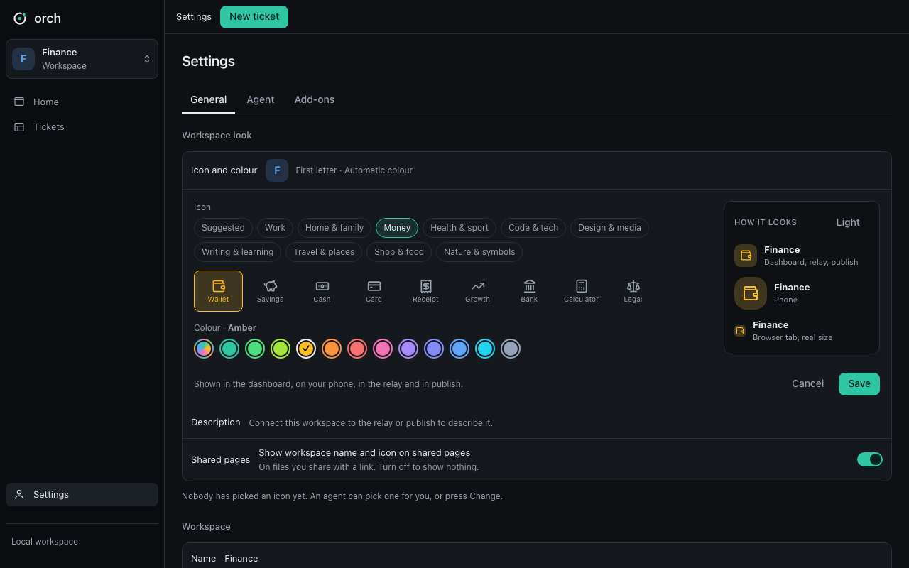

# Dashboard

One page on your own computer with all your tickets and what needs you. It is optional and read from the same files as the `orch` command.


```sh
$ orch addon add dashboard --yes
$ orch start
$ orch status
$ orch stop
```

`orch status` prints the address (this computer only, usually `http://127.0.0.1:8420`).

- **Home:** Needs you first (questions, failed runs), then your tickets, then which agents are working.
- **Ticket page:** tasks with proof, questions, history, owner and due day, and a Continue or Start button for the agent.
  Your clicks count as you; an agent's changes count as the agent.
- **Add-ons:** each add-on you turn on gets its own tab (automation, publish's Shared tab, relay messages).


The board has six columns: Backlog, Ready, Working, Waiting, Review, and Done. Done initially shows three tickets. Review cards offer **Mark done** and **Send back**. An agent's activity appears separately on its ticket; Start moves the card to Working immediately.

Settings ends with **Workflow → Agents may mark tickets Done**, off by default. Browser actions are recorded as a person, including when an agent started the dashboard.

**References** holds tickets, web addresses, project files, and artifacts. Project text and image previews use stored references and the core's safe file reader. Files outside the project say **On this computer only** and remain text. Shared snapshots keep references but do not open files or artifacts.

The live dashboard listens on `/api/events` for changes, with a 20-second fallback refresh while connected and a 3-second refresh while disconnected. Shared snapshots make no requests.

## Workspace look and the switcher

Settings > General > **Workspace look** holds the icon and colour of this workspace, its description, and one switch. **Change** opens
the picker: group chips (Recent, Suggested, then the ten groups of 100 icons), 12 colours plus Automatic (the colour comes from the
name), and a preview (dashboard, phone, browser tab; dark and light). Save applies it at once: the dashboard, the browser tab
(favicon and title "<name> · orch"), the phone, the relay and publish show it. An agent may pick a look too until a person has;
a person's pick is never replaced by an agent. **Description**: Edit sends a proposal; it shows "Waiting for approval" until the owner approves it
in the relay (or publish) admin page. **Show workspace name and icon on shared pages** is on by default and only a person can change it.
The workspace box in the sidebar is a switcher: it lists the workspaces `orch status` knows on this computer (the ones running), with
their badges; another one opens its dashboard in this tab. The dashboard only calls `orch look show|set|shared-pages`,
`orch status --json` and `orch <service> profile`; the signed-in user is the caller (`--by human:<user>`), never a request field.
Files: `web/look.js`, `look.css`, `look-colors.css`, `look-icons.js` (generated by `tools/gen_look_icons.py` from `contracts/look`), `web/switcher.js`.



## Mobile mode

A switch "Mobile mode" sits top right (it shows only when the relay add-on is on). The first click opens a short question first
(questions also go to your phone, the computer stays awake, a closed laptop lid still sleeps; "Don't ask again" is a browser
preference). While it is on, a bar on every page says so, with the start and end time and a Turn off button; if the computer could
not be kept awake the bar says so. Settings > General > Mobile mode picks the auto-off time (4, 8, 12 or 24 hours, default 12).
After a restart or an automatic end a one-line notice stays until you press OK. The dashboard only calls
`orch relay mobile on|off|hours|ack|status --json`; the mode itself lives in `.orch/run/mobile-mode.json`, not in the browser.


