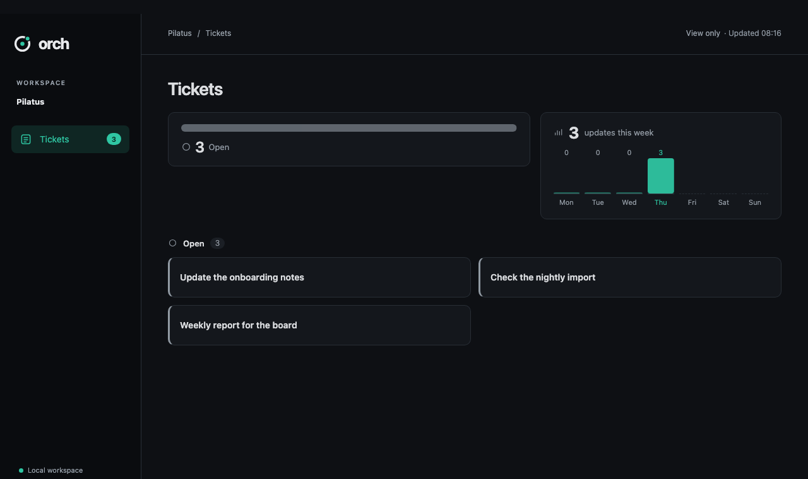
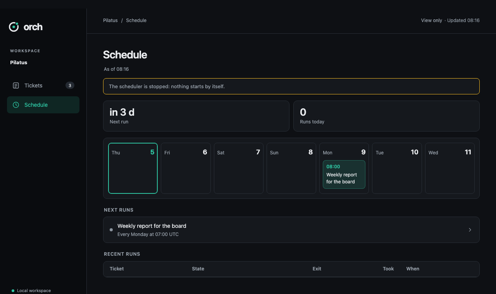

# orch-workspace-addons (dashboard, scheduler, publish, relay, your own)

Add-ons are split from the core but feel like one product once turned on. The core knows no add-on by name; everything
goes through the add-on contract: `contracts/addon-manifest.md` (manifest, activation, CLI rules, views, skills, ticket data).

## What they do
**Publish** and **relay** (built into the orch package, `workspace/src/orch/builtin/<name>/orch-addon.toml`): the clients for the
publish and relay servers. Nothing to install; `orch addon add publish|relay` asks, then adds the command, skill and AGENTS.md entry.
The admin pages' "Add workspace" prompt runs `orch addon add <name> --yes` before `connect`.
**Dashboard** (optional host): a light, read-only web page on the laptop. Built-in tabs: Tickets, and Inbox when the relay add-on is
on and set up in this workspace (configured, not "online right now"). Plus one tab per active add-on with `[dashboard]`, rendered from
`orch <name> view --json` blocks, and add-on rows in the ticket detail from `[[ticket_view]]`. No buttons that change data.
Optional: a read-only snapshot published as a private publish app (add-on content left out by default).
**Scheduler:** starts agent runs: wakes tickets that wait until a time (`waiting_on.kind = time`), repeats by cron
(`ext.scheduler`), and starts work the relay inbox brings.

## Tech stack
Python 3.12, uv. Add-ons talk to the core only through the `orch` CLI (`--json`), never by importing it. Dashboard: stdlib
`http.server` + plain HTML/CSS/JS (orch `tokens.css`, orbit logo, fixed icon set; no React, no build step). Scheduler: `croniter`, `subprocess`.

## Folder layout
```
workspace-addons/
  dashboard/  pyproject.toml  src/orch_dashboard/{orch-addon.toml, __main__.py, server.py, service.py, blocks.js, snapshot.py, skills/orch-dashboard/}  tests/
  scheduler/  pyproject.toml  src/orch_scheduler/{orch-addon.toml, ext.schema.json, __main__.py, loop.py, runner.py, view.py, service.py, skills/orch-scheduler/}  tests/
```
`pyproject.toml` registers `[project.entry-points."orch.addons"] <name> = "<module>"`. `orch addon add dashboard|scheduler`
installs (if needed) and turns the add-on on in this workspace.

## Turn on, turn off
| You run | Result |
|---|---|
| `orch addon add scheduler` | Shows what it brings (command, skill + AGENTS.md entry, ticket data key, dashboard tab, background process) and asks "Add it? [y/N]" in a terminal; `--yes` skips the question (without a terminal and without `--yes` it is refused with that hint). Installs it on this computer if needed, then turns it on **in this workspace only** |
| `orch addon add ./my-addon` | Same for a local folder, labelled "local (not checked by orch)". Change anything in the folder later and it is off until you add it again (`orch update` tells you: "changed on disk") |
| `orch addon list [--json]` | What is installed and what is on here |
| `orch addon remove scheduler [--purge]` | Off in this workspace: stops its process, removes its skill and AGENTS.md entry, tab and ticket rows. Ticket data (`ext.scheduler`) stays in the files, hidden; `--purge` also deletes `.orch/addons/scheduler/` and the `[scheduler]` settings |
| `orch addon uninstall scheduler` | Removes it from this computer (only when it is off here; not for publish/relay, which are part of orch) |

Built-in add-ons install from where orch itself came from (the repo and branch of the install, e.g. `ORCH_REF=develop`), so orch and its add-ons always match.

With no add-on on (publish and relay included), orch shows no trace of them: not in `orch --help`, skills, AGENTS.md or the dashboard. Only the user turns one on:
a `.orch/addons.json` that arrives with a git clone activates nothing (the command answers with `orch addon add <name>`); the proof
of consent lives on this machine under `~/.orch-tool/` (`contracts/addon-manifest.md`). `ORCH_HOME` is honoured only for a plain folder under the real home.




## Commands
| Command | Does |
|---|---|
| `orch start` / `orch stop` / `orch status` (core) | Starts / stops every active add-on's background process in this workspace (dashboard + scheduler); `stop` outside a workspace asks which one. `contracts/addon-manifest.md`, Background |
| `orch dashboard` | Serves `127.0.0.1:8420`: Tickets, Inbox (relay set up), add-on tabs. Reads tickets via `orch ticket list --json`, add-ons via `orch addon list --json`, tab content via `orch <name> view --json` (2 s timeout, last good result kept, "as of HH:MM") |
| `orch dashboard start` / `stop` / `status` | Serves in the background (8420, or a free port when another workspace has it); pid, port and nonce in `.orch/run/dashboard/server.json` (gitignored); `stop` signals only a verified server (start time, command line, `/ready` challenge answered with HMAC of the nonce and the same pid); `start --json` gives the `url` |
| `orch dashboard snapshot --publish [--with-addons]` | Static HTML of the same pages → `orch publish app` (static, private) |
| `orch scheduler run` / `--once` | Loop every 60 s (below) / one pass |
| `orch scheduler start` / `stop` / `status` | Background process; `stop` also runs on `orch addon remove scheduler` |
| `orch scheduler repeat <id> "<cron>" [--agent codex]` / `--off` | Sets `ext.scheduler {recurring, cron, agent}` via `orch ext set` |
| `orch scheduler list` | Next wake-ups and repeats, in plain words |
| `orch scheduler view --json` | Dashboard tab: next run, runs today, failed runs, a 7-day calendar strip (a repeat more often than hourly is one card per day: "Every 5 min · next 15:05 · 288 runs/day"; hourly or less shows each time), next runs (one line per ticket), repeating list in plain words ("Every 5 minutes", "Mondays at 08:00", local time), recent runs |

Scheduler pass (only while active in this workspace; exits when turned off):
1. Ticket waiting with `waiting_on.kind = time` and `until <= now`, status not done/dropped → `orch wait <id> --clear`, run agent.
2. `ext.scheduler.recurring` with `cron` due (5-field, UTC) → run agent. Missed runs (machine off) → one catch-up run.
3. `orch relay inbox --json` (only if the relay add-on is on here and set up; otherwise no inbox pass). Run agent for an allowed `start`/`delegate`, or an `answer`/`webhook` for a ticket waiting on it.
4. Run = `[scheduler] agent` from `.orch/config.toml` with prompt `Continue orch ticket <id>. Read .agents/skills/orch/SKILL.md first.`;
   runs start through `orch run start` (one run per ticket at a time); logs in `.orch/run/logs/`; `orch log … --by agent:scheduler`; `ext.scheduler.last_run`.

## Data storage
Each add-on writes only `ext.<name>` (through the CLI) and `.orch/addons/<name>/`. Config: its `[<name>]` table in `.orch/config.toml`.
Dashboard writes nothing but its runtime files in `.orch/run/dashboard/` (background run). Scheduler runtime files (pid record, log of the background process) are in `.orch/run/scheduler/`.

## Write your own add-on
1. A Python package with `orch-addon.toml` next to `__init__.py` (`contracts/addon-manifest.md`; minimal example
   `contracts/examples/addon-manifest/valid-minimal.toml`) and a `__main__.py` that parses argv. Name `[a-z0-9-]`, not a core command.
2. Entry point `[project.entry-points."orch.addons"] <name> = "<module>"`. Try it: `orch addon add ./my-addon`.
3. Commands: `orch <name> …`; every command takes `--json`; exit 0 ok, 2 refused (`Refused: …` / `{"error": …}`).
   Use only the public CLI (`$ORCH_BIN ticket list --json`, `ext set`, `ticket patch --if-revision`, `log`, `wait`), never the ticket files.
4. Your space: `.orch/addons/<name>/`, ticket key `ext.<name>` (with a `ticket_ext` JSON Schema), config table `[<name>]`.
5. Dashboard tab: `[dashboard]` label + icon from the fixed set, and `orch <name> view --json` returning
   `contracts/addon-view.schema.json` blocks (stat, list, calendar, timeline, chips, table). Ticket detail rows: `[[ticket_view]]`.
6. Skill `skills/orch-<name>/SKILL.md` + `AGENTS-block.md`, short, plain words, same tone as the core skills.
7. Background process? `background = true` and `start` / `stop` / `status` commands with `--json` (`orch start` / `orch stop` call them); runtime files in `.orch/run/<name>/`; check that you are still active on each pass.
**Security:** no HTML, CSS or JS reaches the dashboard: only the declared blocks, shown as plain text; links only to tickets or
`https://`. No actions from the dashboard. A local add-on runs code on this computer with your rights — install only what you trust.

## End-to-end
`e2e/run.sh A` (local mode, no live servers needed) covers A0-A15: add/remove, no trace without add-ons, the clone case, consent for local
folders, stale views, snapshots (`docs/e2e-scenarios.md`). The fixture add-on is `e2e/fixtures/hello-world`; it is the smallest working example
of the steps above. `e2e/run.sh agents` runs the real-agent scenarios (claude, codex) with the scheduler on; `e2e/walkthrough/run.sh` takes the screenshots.

## Tests
- T0: `uv run pytest tests/test_loop.py -k cron -x -q` (scheduler), `uv run pytest tests/test_blocks.py -x -q` (dashboard).
- Scheduler: fake clock, fake relay, fake agent command; `view --json` output validated against `contracts/addon-view.schema.json`.
- Dashboard: page tests per block type and for loading/stale/error states; Playwright click-through in e2e. CI: `workspace-addons/**`, `workspace/**`, `contracts/**`.

## Not included
Editing or actions in the dashboard, add-on HTML/JS, git-URL installs, login, multi-workspace dashboard, run limits or budgets.
